# Hoshiyar · ہوشیار

Check a suspicious message before you reply. Paste an SMS or WhatsApp message, or add a screenshot, voice note, QR code, PDF or email, and Hoshiyar tells you whether it looks like a scam, why, and what to do next, in English, Urdu or Roman Urdu.

Built for the messages people in Pakistan actually get: fake BISP payments, "I sent my code to you by mistake", e-challans from personal numbers, prize draws that need a fee, a relative on a new number asking for money, look-alike bank links, fake overseas job offers. Behind the public checker sits a small threat-intelligence workflow: a review queue, campaign grouping, a watchlist, and STIX 2.1 export for CERTs and police.

"Hoshiyar" (ہوشیار) means "alert" or "be careful" in Urdu.

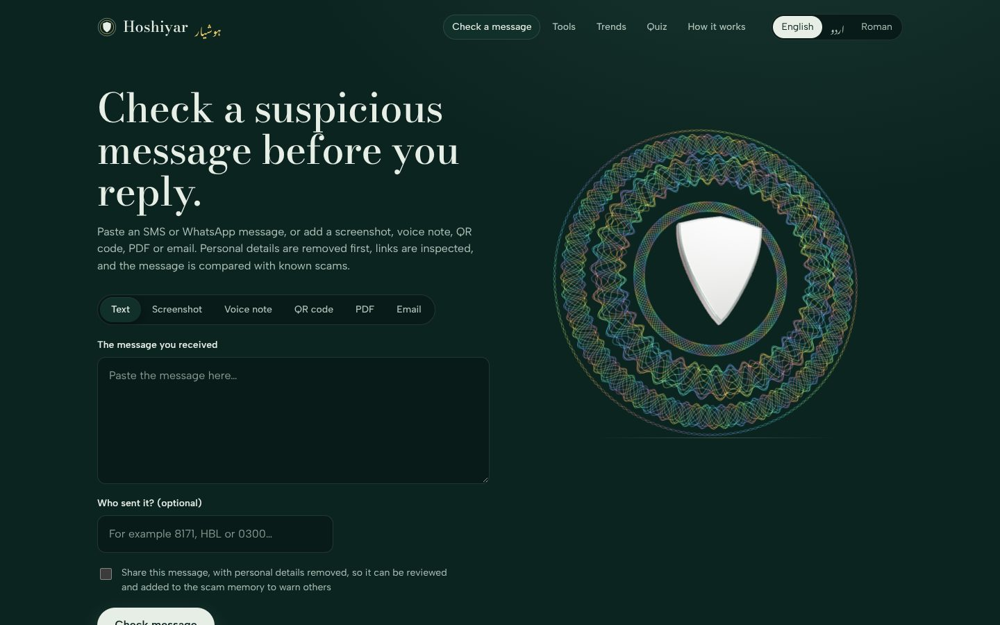

| Likely scam | No red flags | Urdu |
|---|---|---|
| 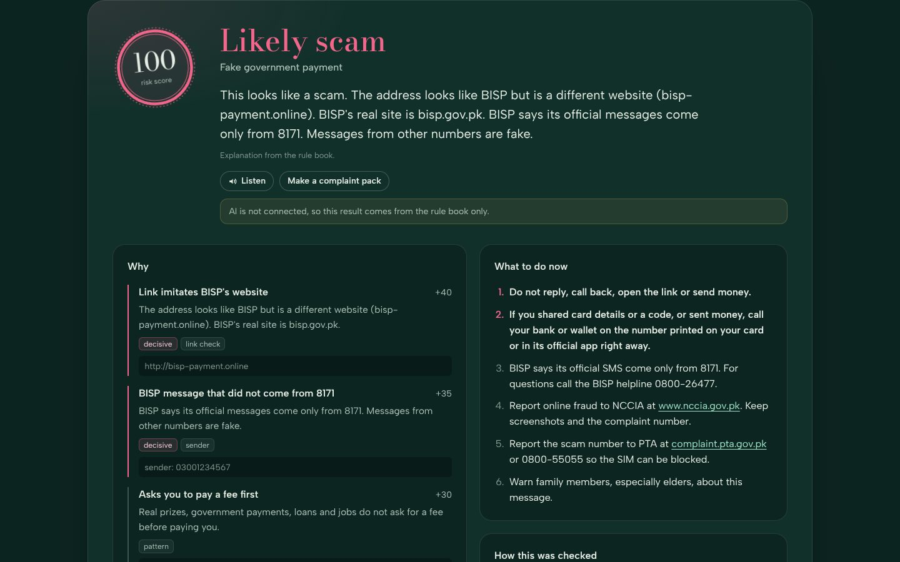 | 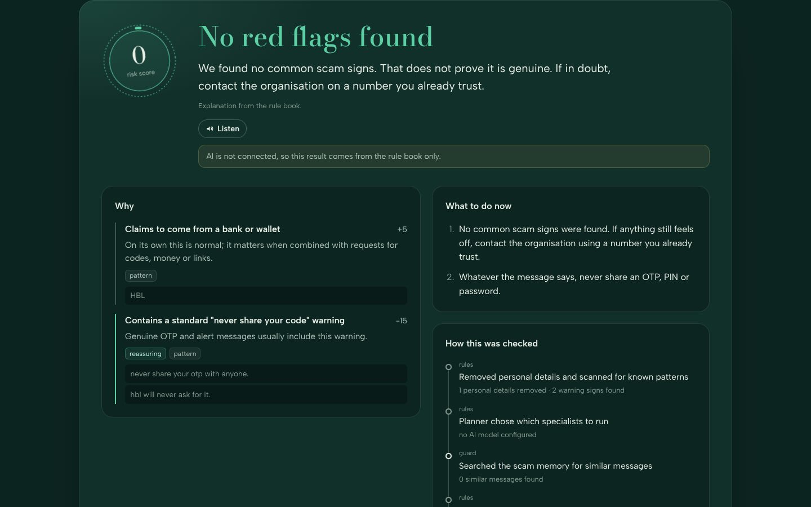 | 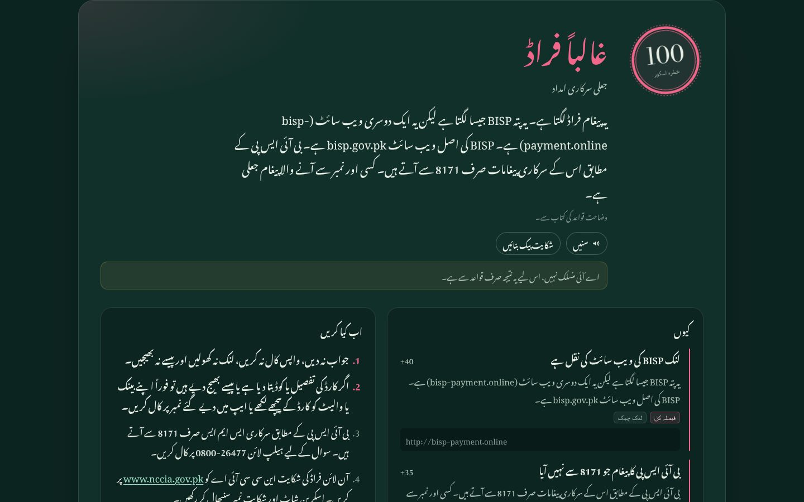 |

## The idea: the model reads, the rules decide

Language models are good at reading messy, mixed-language text and at deciding what to look into. They are not good at being consistent or explaining exactly why they decided something. So Hoshiyar splits the job:

| Step | Who | What happens |
|---|---|---|
| 1. Redact | code | Phone, CNIC, card and bank-account numbers, IBANs, emails and one-time codes become placeholders before the message enters the pipeline. Numbers are kept only as HMAC fingerprints. |
| 2. Pattern scan | code | Regex vocabularies in English, Urdu, Roman Urdu and common Pashto, Sindhi and Punjabi words. Disguised links (`hbl-verify[.]com`, `hxxps://`, `dot com`), look-alike Cyrillic letters, spaced-out words (`O T P`) and text aimed at fooling an AI are caught too. |
| 3. AI reading | LLM | The model describes the message as structured data (who it claims to be, what it asks for, what pressure it applies, whether it talks to an AI). It never gives a verdict. Readings are cached per redacted text. |
| 4. Planning | code | A rules-based planner decides which specialist agents to run. |
| 5. Specialists | AI agents | A link specialist (`check_link` tool) and a memory specialist (`search_similar_reports` tool) run in parallel, each with its own tool loop. |
| 6. Guard | code | Checks every link a specialist skipped, refuses links that are not in the message, and looks up the watchlist and reported numbers and accounts. |
| 7. Rule book | code | 50 published rules score the evidence (0–100) and decide: `likely_scam`, `suspicious` or `no_red_flags`. |
| 8. Explain | LLM + code | The model explains the result in the user's language. If it contradicts the verdict it is discarded. Next steps and reporting channels are fixed text. |
| 9. Review | people + code | Shared messages go to a review queue. Approved reports join the scam memory and are grouped into campaigns. |

Safeguards that keep the model in its lane:

- A signal found **only** by the model counts for 70% of a rule's weight and can never trigger a decisive ("hard") rule.
- The message is passed to every model as untrusted data; instructions inside it are reported, never followed, and a message that addresses the checker is itself a decisive warning sign.
- The same message always gets the same verdict, because the verdict comes from code. A CI quality gate fails if a change makes the numbers worse.

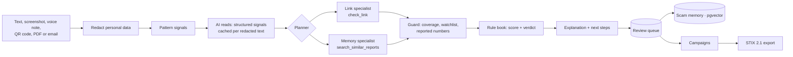

## What it can do

**For people who receive a suspicious message**

- **Six inputs**: text, screenshots (Gemini vision), voice notes (Whisper on Groq, also recorded in the browser), QR codes (decoded on the device; payment codes show who would be paid), PDFs (text, clickable links, hidden JavaScript and embedded files) and emails (`.eml` or pasted source: SPF/DKIM/DMARC results, a bank's name sent from another domain, free-webmail senders, reply-to tricks, risky attachments, links hidden behind other link text).
- **Languages**: English, Urdu (Nastaliq, right to left) and Roman Urdu for the interface and the answers. Pashto, Sindhi and Punjabi messages are recognised and answered in Urdu.
- **Links checked without visiting the site**: look-alike domains, homograph addresses (`һbl.com` with a Cyrillic һ), short links expanded by reading only the redirect header, domain age from RDAP, Google Safe Browsing v5.
- **Follow-up questions** ("I already sent money, what now?"), each check is a LangGraph thread.
- **Read aloud** with the device's own voice, and a **complaint pack** for NCCIA or PTA built on the device, with the original message.
- **Report a scam website**: registrar and abuse contact from RDAP, a ready-to-send email, and Google's phishing report form.
- **Lookups**: is this phone number, website or bank account in reviewed reports or on the watchlist? The value is never stored.
- **Payment screenshot check** (experimental): reads a "payment sent" screenshot and points out inconsistencies, with the one reliable advice: check your own app.
- **Family alerts**: a relative gets a Telegram alert (scam type only, never the message) when a check from your browser or chat comes back as a likely scam.
- **Spot the scam** quiz, installable **PWA** with a share target (share a WhatsApp message straight to Hoshiyar), **browser extension**, **Telegram bot**.

**For analysts**

- **Review panel** with logins and roles (analyst, admin).
- **Review queue**: a report is approved automatically only when a decisive, pattern-backed rule fired; everything else waits for a person.
- **Poisoning protection**: pasting someone's number or website into a fake scam does not get it flagged. A number or account counts as reported only after a reviewer approves it or several different Telegram accounts report it (browser ids are free to fake, so they never count alone). A website goes into public lists, lookups, the weekly warning and STIX only after review, or when a deterministic link check confirmed it.
- **Campaigns**: reports that share a website, URL, number or account, or read alike in the same category, are grouped.
- **Watchlist** of confirmed websites, numbers and accounts (numbers stored as fingerprints with masked labels); a match is a decisive rule.
- **Official domains** an admin can add without a code change.
- **Rule-suggestion agent**: proposes a regular expression from missed scams and tests it against the evaluation sets (must match a missed scam, no legitimate message, and finish quickly). Never applied automatically.
- **STIX 2.1 export** of confirmed scam websites and links, without query strings (validated with the `stix2` library in the tests). Fingerprints are never exported.
- **Weekly warning** to a Telegram channel, scheduled by GitHub Actions.
- **MCP server** so AI assistants (Claude Desktop, Cursor) can use the check, lookup and campaign tools.

| Email check | QR payment code | Review queue |
|---|---|---|
| 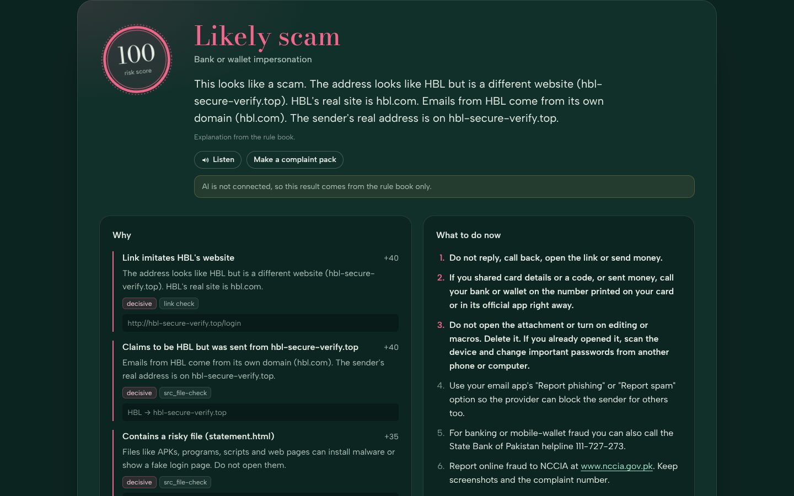 | 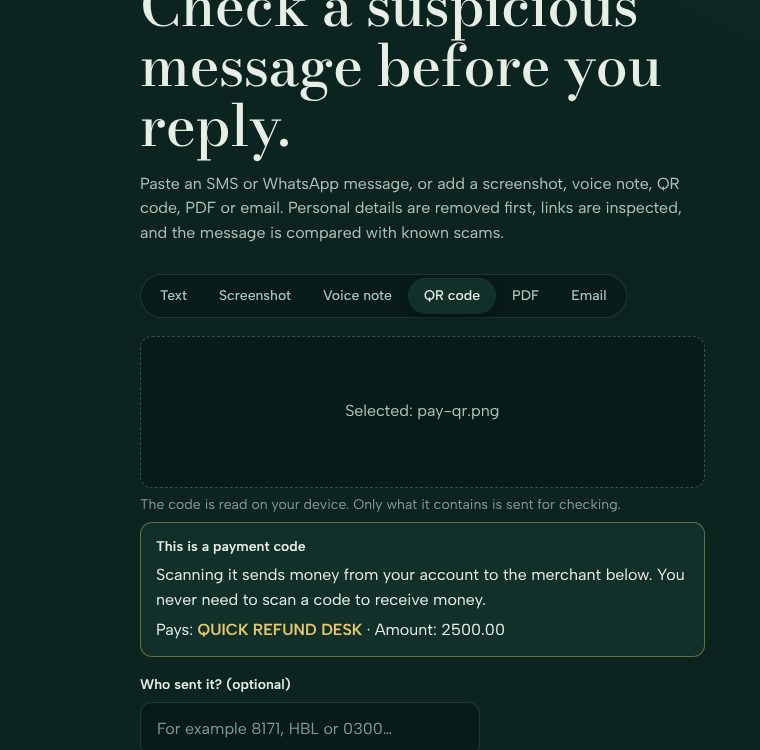 | 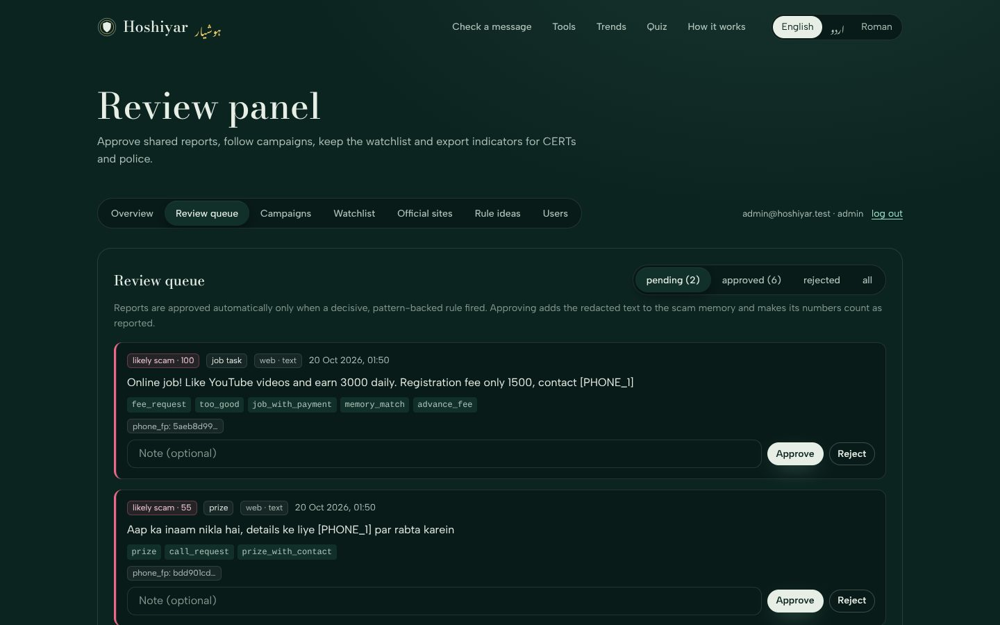 |

| Tools | Campaigns and weekly warning | Extension warning |
|---|---|---|
| 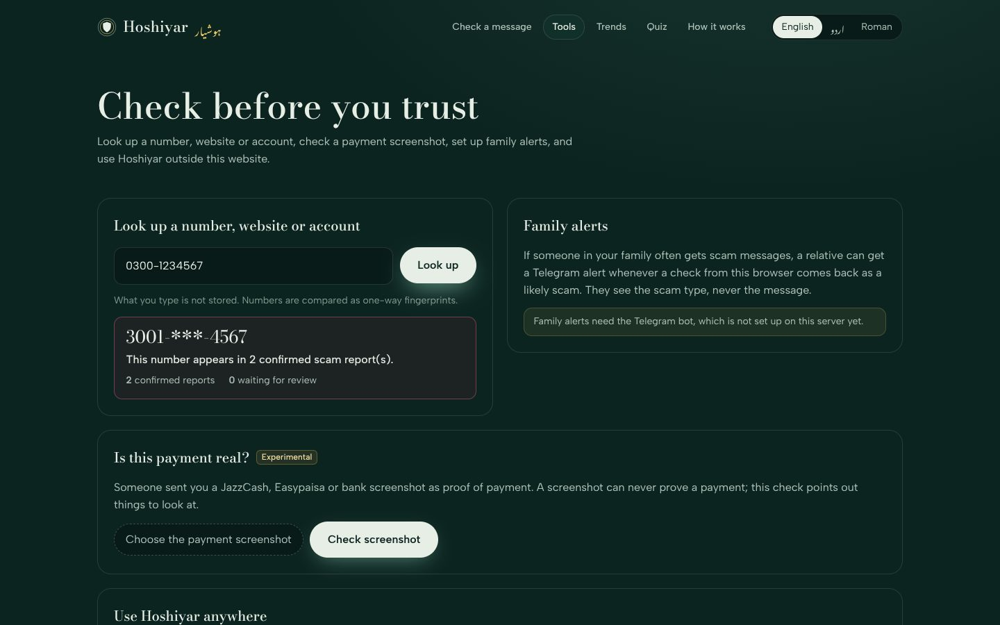 | 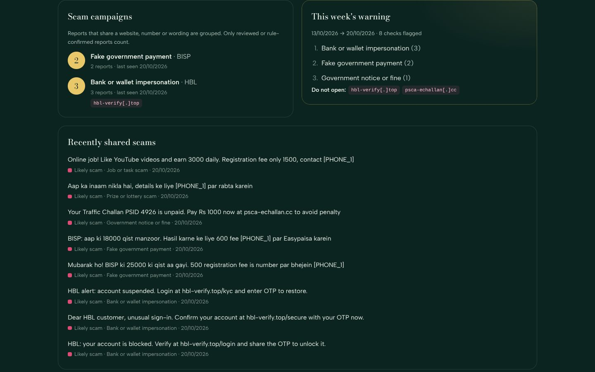 | 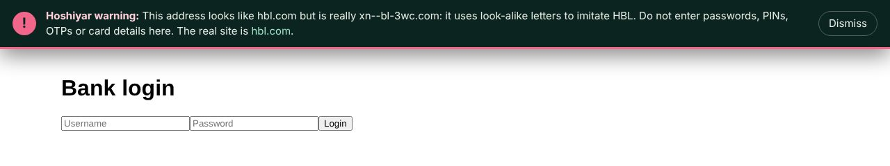 |

## Evaluation

`python -m eval.run_eval` runs the full LangGraph pipeline over two labelled sets and writes `eval/results.md` and `eval/results.json` (shown on the site's Quality page). `python -m eval.redteam` runs 22 attempts to fool the checker plus controls. Network link checks are off so results are reproducible.

| Set | Messages | Precision | Caught as likely scam | Flagged at all | False alarms |
|---|---|---|---|---|---|
| Test (written after the rules were frozen) | 60 | 100% | 77.8% | 97.2% | 0 / 24 |
| Dev (used for tuning) | 100 | 100% | 98.3% | 100% | 0 / 40 |
| Red team (prompt injection, disguised links, look-alike letters, controls) | 22 | | | 22 / 22 passed | |

These numbers are for **rules and pattern memory, no AI**. All sets were written by me to reflect real Pakistani scams, so treat them as a sanity check, not a benchmark. The red-team cases were written together with the defences, so they are regression tests, not proof that the checker cannot be fooled. Most test misses are scored "suspicious" rather than "likely scam". `--with-ai` adds a row for the full AI pipeline.

`python -m eval.gate` compares the results with `eval/thresholds.json`; CI fails if precision, recall, false alarms or the red-team pass rate get worse.

## Tech stack

| Part | Choice |
|---|---|
| Backend | Python 3.12, FastAPI, async SQLAlchemy |
| Agents | LangGraph: parallel specialist nodes with manual tool loops, a rules-based planner, checkpointer and store |
| LLMs | Groq (`openai/gpt-oss-120b`, `openai/gpt-oss-20b` for agents, Whisper) and Gemini, in one fallback chain; failing models are parked and retired ones replaced at start-up |
| Memory | Postgres + pgvector via LangGraph's `AsyncPostgresStore` and `AsyncPostgresSaver`; in-memory locally |
| Embeddings | Gemini embeddings, or a local character n-gram hashing embedder (no API needed) |
| Files | `pypdf`, Python's `email` package, EMVCo QR parsing, `regex` with timeouts for rule ideas |
| Integrations | MCP (`mcp` 2.x), STIX 2.1, Telegram Bot API, Cloudflare Turnstile (optional) |
| Frontend | React 19, TypeScript, Vite, three.js via React Three Fiber, jsQR, PWA |
| Extension | Chrome Manifest V3, no build step |
| Tests | pytest (157 tests incl. scripted-LLM agent tests, model-failure handling and security regressions), node:test for the extension, GitHub Actions with a quality gate |
| Hosting | Render (API), Vercel (frontend), Neon (Postgres), GitHub Actions (schedules), all on free tiers |

## Run it locally

You need Python 3.12+, Node 20+ and Git.

```bash
# Backend
cd backend
python -m venv .venv
# Windows: .venv\Scripts\activate    macOS/Linux: source .venv/bin/activate
pip install -r requirements-dev.txt
cp .env.example .env        # optional: add API keys, see docs/SETUP.md
python run.py --reload      # or: uvicorn app.main:app --reload
# → http://localhost:8000/docs

# Frontend (new terminal)
cd frontend
npm install
npm run dev
# → http://localhost:5173
```

With no keys the app runs in rules-only mode with SQLite and in-memory agent memory. Add keys one at a time; `GET /api/health` shows what is switched on. Set `ADMIN_EMAIL` and `ADMIN_PASSWORD` in `.env` to create the first review-panel account (open `/admin`).

Tests and evaluation:

```bash
cd backend
pytest -q
python -m eval.run_eval                        # rules only, no API calls
python -m eval.redteam                         # red-team set
python -m eval.gate                            # the CI quality gate
python -m eval.run_eval --with-ai --limit 20   # adds the full AI pipeline on 20 test messages
python -m eval.calibrate_memory                # pick a similarity threshold for your embedder
node --test ../extension/test/*.test.js        # extension look-alike detector
```

The evaluation never touches your `DATABASE_URL`; it uses a temporary SQLite file. The AI run spends free-tier quota (about 4-6 model calls per message), waits 20 seconds between messages by default, and reports any message where a model call failed.

On Windows, start the API with `python run.py` or `uvicorn app.main:app --reload`. Plain `uvicorn app.main:app` uses an event loop that the async Postgres driver does not support; the app stops at startup with a message saying so.

## Deploy for free

Step by step in [`docs/SETUP.md`](docs/SETUP.md): Neon for Postgres, Render for the API, Vercel for the frontend, the Telegram bot, the review panel, scheduled jobs on GitHub Actions, the browser extension and the MCP server.

## API

| Method | Path | Purpose |
|---|---|---|
| POST | `/api/analyze` | Check text or decoded QR content: `{text, sender?, share?, language?, source_kind?, client_id?}` |
| POST | `/api/analyze/upload` | Check a screenshot, voice note, PDF or `.eml` file (multipart `file`) |
| POST | `/api/analyze/email` | Check pasted email source: `{raw}` |
| POST | `/api/followup` | Ask about a previous check: `{thread_id, question}` |
| POST | `/api/lookup` | Is this number, website or account reported? `{value}` |
| POST | `/api/takedown` | Registrar, abuse contact and report links for a scam site |
| POST | `/api/receipt` | Experimental payment-screenshot check |
| POST | `/api/family/code` · `/status` · `/remove` | Family alerts |
| POST | `/api/me/forget` | Delete the data linked to this browser |
| GET | `/api/campaigns` · `/api/alerts/latest` · `/api/stats` | Public trends |
| GET | `/api/quality` · `/api/privacy` · `/api/rules` · `/api/channels` | Evaluation numbers, retention, rule book, reporting channels |
| GET | `/api/health` · `/api/health/ai` | What is enabled; one test call to each model |
| POST | `/api/auth/login` | Review-panel login (returns a short-lived token) |
| * | `/api/admin/*` | Review queue, campaigns, watchlist, official domains, rule ideas, users, STIX export, purge |
| POST | `/api/cron/weekly` · `/api/cron/purge` | Scheduled jobs (`X-Cron-Secret` header) |
| POST | `/api/telegram/webhook` | Telegram updates |

## Privacy

- Personal identifiers (phone, CNIC, card, account and IBAN numbers, emails, one-time codes, also when written with spaces, and inside link query strings) are removed before text enters the pipeline, is sent to any model or is stored. The raw message never reaches the database or the conversation store; a mobile sender number is masked and fingerprinted. Email subjects and sender names are redacted too.
- Phone numbers and accounts are stored only as keyed hashes, and only count as "reported" after review or reports from several Telegram accounts.
- Shared messages are stored redacted, for reviewers, and appear on the public trends page only after a reviewer approves them. Lookups, payment screenshots, QR images and complaint packs are never stored.
- Old data is deleted on a schedule (checks and their threads after 180 days, rejected reports after 30, AI cache after 7), and anyone can delete the data linked to their browser from the Privacy page.
- Free-tier model APIs may use prompts to improve their products, which is another reason redaction happens first. Screenshots and voice notes cannot be redacted before they are read; the interface says so.
- The browser extension checks look-alike sites locally; the pages you visit are never sent anywhere.
- Fonts are bundled with the app; the frontend makes no third-party requests (Cloudflare Turnstile loads only if you enable it).

## Limitations

- Rules are written for Pakistani English, Urdu and Roman Urdu scams; Pashto, Sindhi and Punjabi get a few common words plus the AI reading.
- Without network checks, a new phishing domain that does not imitate a known brand can slip through.
- The payment-screenshot check is experimental and can never prove a payment is real or fake.
- Reporting channels and official domains were checked in October 2026 and need periodic review (`backend/data/`, `app/rules/brands.py`).
- This is guidance, not a guarantee.

## Project layout

```
backend/
  app/
    agent/      LangGraph graph (planner, specialists, guard), state, explanations
    ai/         model factory, structured signals, prompts, screenshot and voice reading
    api/        public routes, tools, review panel, cron jobs, Telegram bot, captcha
    core/       text normalisation, redaction, URL parsing
    db/         tables and dashboard stats
    files/      PDF, email, QR and payment-screenshot readers
    guidance/   next steps
    intel/      review queue, campaigns, indicators, lookups, watchlist, STIX, alerts,
                family alerts, retention, AI cache, rule-suggestion agent, takedown help
    memory/     embeddings and long-term memory
    rules/      brands, pattern signals, rule book, scoring
    tools/      link checks (RDAP, Safe Browsing, short links)
    auth.py     review-panel accounts
    mcp_server.py
  data/         scam pattern library (synthetic), reporting channels
  eval/         dev/test/red-team sets, evaluation, quality gate, calibration
  tests/
frontend/
  public/       PWA manifest, service worker, icons
  src/
    components/ seal (three.js), forms, result view, complaint pack, read aloud, takedown
    pages/      check, tools, trends, quiz, how it works, quality, privacy, review panel
extension/      Chrome MV3 extension (context-menu check, look-alike warning)
docs/
```
